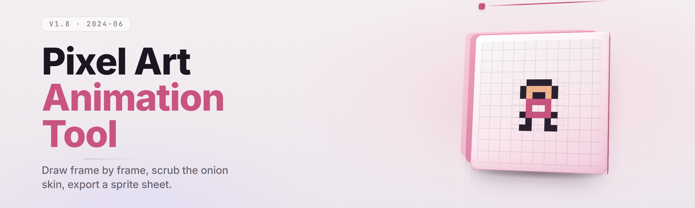

  
  
  

  

  
  

---

## ⚙️ Module Status

| Subsystem | State | Last Verified |
| --- | --- | --- |
| Timeline & Keyframe Core | ✅ Working | 2026-01-14 |
| Onion-Skin Renderer | ✅ Working | 2026-01-14 |
| Palette Forge | ✅ Working | 2026-01-14 |
| Sprite Sheet Exporter | ✅ Working | 2026-01-14 |
| Tiling Preview | ✅ Working | 2026-01-14 |
| GIF / WebP Encoder | ✅ Working | 2026-01-14 |
| Aseprite Import Bridge | ✅ Working | 2026-01-13 |
| Frame Tagging & Loop Control | ✅ Working | 2026-01-13 |
| GPU Brush Engine | ✅ Working | 2026-01-12 |
| Undo Stack (non-linear) | ✅ Working | 2026-01-12 |

All ten primary subsystems report green on the 2026-01 build. Secondary modules are listed in the catalog below with their individual states.

---

## 🕹️ What is Pixel-Art Animation Studio

Pixel-Art Animation Studio is a Windows desktop `.exe` for creating frame-by-frame pixel-art animations — sprites, walk cycles, idle loops, UI motion, tileset animations — without a browser, an account, or a runtime install. You download it, extract it, run the `.exe`, and start drawing on a pixel grid.

| Term | Explanation |
| --- | --- |
| Frame | A single pixel grid rendered at one point in time; the atomic unit of an animation. |
| Keyframe | A frame you draw deliberately; the timeline interpolates nothing for pixel art — every frame is drawn. |
| Onion Skin | A translucent overlay of the previous and next frames so you can align motion. |
| Sprite Sheet | A single image containing all frames laid out in a grid, consumed by game engines. |
| Palette Index | The integer slot a pixel points to; changing the palette swaps colors without repainting. |
| Tag | A named range of frames (e.g. `walk`, `idle`) that exports as a labeled animation. |
| Tiling Preview | A mode that repeats your canvas in a grid so seamless tiles can be checked live. |

**Why pixel artists keep it open:**

- Pixel-perfect drawing tools that snap strokes to whole pixels — no sub-pixel blur, ever.
- Timeline, onion skin, and preview all run in one window; no alt-tabbing to a second app.
- Exports straight to sprite sheet, GIF, WebP, and APNG with per-tag slicing.
- Palette-first workflow: repaint a whole animation by editing one ramp.
- Runs offline from a folder — no installer, no admin rights on most systems.

---

## 📦 The Problem

- Most animation tools treat pixels as an afterthought — brushes blur, transforms interpolate, and your grid drifts off by half a pixel.
- Sprite sheet export means opening a separate tool, counting frames by hand, and praying the grid math is right.
- Onion skin in general-purpose editors is either missing or so heavy it tanks the preview framerate.
- Palette swaps require repainting every frame when the tool doesn't support indexed color.
- Timeline scrubbing is laggy on large canvases because the whole frame re-renders on every tick.
- Looping GIF export silently drops the last frame or double-counts it, breaking the loop.
- Coordinating frame tags with a game engine's animation state machine is manual and error-prone.

## 🧩 The Solution

| Problem | Solution |
| --- | --- |
| Sub-pixel drift | All brushes, transforms, and paste operations quantize to the integer grid by default. |
| Manual sprite sheet math | Exporter takes frame count, columns, padding, and tag ranges; produces the sheet and a JSON atlas. |
| Heavy onion skin | Onion layers render on a separate GPU pass with configurable opacity and range (1–5 frames). |
| Palette repaint | Indexed-color mode stores a palette index per pixel; editing the ramp updates every frame instantly. |
| Laggy scrubbing | Frames cache as GPU textures; scrubbing re-binds textures instead of re-rasterizing. |
| Broken GIF loops | Encoder exposes explicit loop count, per-frame delay, and a "hold last frame" toggle. |
| Tag/engine mismatch | Tag export writes a JSON manifest with frame ranges, names, and durations for direct engine import. |

---

## 🎬 Timeline & Keyframe Core

- **Frame Strip** — horizontal filmstrip of every frame with drag-to-reorder and range-select.
- **Non-linear Undo** — history is a tree, so you can branch, undo a branch, and keep the other.
- **Frame Tags** — name a range (`walk`, `idle`, `attack`) and it becomes an export unit.
- **Loop Markers** — set in/out points independent of tags for previewing partial loops.
- **Duration Per Frame** — assign per-frame hold times in milliseconds for variable-speed animation.

## 🧅 Onion-Skin Renderer

- **Multi-Frame Range** — show 1 to 5 frames before and after, each with its own tint.
- **Tint Control** — previous frames tint red, next frames tint blue by default; both editable.
- **Opacity Ramp** — each step back fades by a configurable percentage.
- **Peel Mode** — hide the current frame entirely to draw "between" two references.

## 🎨 Palette Forge

- **Indexed Color Mode** — every pixel stores a palette slot, not an RGB triple.
- **Ramp Generator** — build a ramp from a base hue with adjustable saturation and value steps.
- **Palette Lock** — lock a ramp so accidental clicks can't repaint it.
- **Import/Export** — read and write `.pal`, `.gpl`, and `.hex` palettes.
- **Palette Swap Preview** — cycle palettes on the whole animation to test time-of-day variants.

## 🖌️ Drawing Tools

- **Pixel Pencil** — 1px hard pencil with optional symmetry (horizontal, vertical, both).
- **Dither Brushes** — 2×2, checkerboard, and 50% Bayer dither patterns as brushes.
- **Shape Tools** — line, rectangle, ellipse, and filled variants, all integer-snapped.
- **Selection & Move** — rectangular and freeform selection with pixel-exact move and stamp.
- **Fill & Replace** — flood fill with tolerance 0 by default; global color replace across frames.

## 🧵 Sprite Sheet Exporter

- **Grid Layout** — choose columns, max rows, and padding between cells.
- **Per-Tag Slicing** — export each tag as its own sheet, or one sheet with all tags.
- **JSON Atlas** — writes frame rectangles, tag names, and durations alongside the PNG.
- **Trim Mode** — crop transparent margins per frame and record offsets in the atlas.
- **Power-of-Two Snap** — optionally pad the sheet to the nearest power-of-two dimensions.

## 🌀 Animation Encoders

- **GIF Encoder** — per-frame delay, loop count, and dither toggle.
- **WebP Encoder** — lossless WebP with alpha for modern engines.
- **APNG Encoder** — animated PNG with full 32-bit alpha and per-frame timing.
- **MP4 Export** — nearest-neighbor upscale for sharing on video platforms.

## 🧱 Tiling & Tileset Tools

- **Live Tiling Preview** — repeat the canvas in a 3×3 or 5×5 grid while drawing.
- **Seamless Check** — highlight edges that don't match when tiled.
- **Tileset Builder** — arrange 16×16 or 32×32 tiles into a sheet with consistent gutters.
- **Auto-Tile Preview** — preview a simple 47-tile auto-tile layout from your tileset.

## 🧭 Aseprite Import Bridge

- **`.ase` Reader** — import layered Aseprite files with frames, tags, and palettes intact.
- **Layer Flattening** — flatten on import or keep layers as separate animation tracks.
- **Tag Preservation** — Aseprite frame tags map directly to Studio tags.

---

  

## 🚀 Quick Start

1. 🖱️ Open the project page and grab the release archive for Windows.
2. 📂 Extract the archive to any folder — no installer, no admin rights required on most systems.
3. ▶️ Run the `.exe`. First launch creates a config folder next to it.
4. 🎨 Draw frame 1, press `N` to add a frame, and turn on onion skin with `O`.
5. 💾 Export via `File → Export → Sprite Sheet` or hit `Ctrl+E`.

## 📥 Installation

1. **Download** — from the project page, take the latest Windows archive. It ships as a `.zip`; no `.msi`, no `.exe` installer, no Python, no Node.
2. **Extract** — unpack into a folder you control (e.g. `C:\Tools\PixelArtStudio`). Windows SmartScreen may warn on a fresh download; choose *More info → Run anyway*.
3. **Run** — double-click the `.exe`. Settings, palettes, and autosaves live in a `config` folder created beside it, so the whole thing stays portable on a USB stick.

---

## 🧮 System Requirements

| Component | Minimum | Recommended |
| --- | --- | --- |
| OS | Windows 10 64-bit (1809+) | Windows 11 64-bit (23H2+) |
| CPU | Dual-core 2.0 GHz | Quad-core 3.0 GHz+ |
| RAM | 4 GB | 8 GB+ |
| GPU | Integrated, OpenGL 3.3 | Discrete, OpenGL 4.5 / Vulkan |
| Display | 1280×720 | 1920×1080 or higher |
| Storage | 300 MB | 1 GB (scratch + exports) |
| Input | Mouse | Mouse + drawing tablet (WinTab) |

## 🖥️ Compatibility / Platform Support

| Platform | Support | Notes |
| --- | --- | --- |
| Windows 10 / 11 (x64) | ✅ Full | Primary target; `.exe` runs from any folder. |
| Windows on ARM | ⚠️ Partial | Runs under emulation; tablet pressure may lag. |
| Wine (Linux/macOS) | ⚠️ Partial | Core features work; GPU brush engine may fall back. |
| Native Linux / macOS | ❌ Not shipped | Not part of this release. |

---

## 🧰 Module Catalog

### 🎞️ Timeline

- **Frame Strip** — reorderable filmstrip with multi-select.
- **Range Select** — shift-click to select a span for bulk ops.
- **Frame Duplicate** — copy a frame or a range in place.
- **Loop Markers** — in/out preview points independent of tags.

### 🎨 Color

- **Indexed Mode** — palette-index pixels.
- **Ramp Generator** — hue-based ramp builder.
- **Global Replace** — swap one index for another across all frames.
- **Palette Cycle** — rotate indices for shimmer effects.

### 🧵 Export

- **Sprite Sheet** — grid layout with padding control.
- **JSON Atlas** — frame rects, tags, durations.
- **GIF / WebP / APNG** — animated encoders.
- **MP4** — nearest-neighbor upscale for sharing.

### 🧱 Tiles

- **Live Tiling** — 3×3 / 5×5 repeat preview.
- **Seamless Check** — edge-match highlighter.
- **Tileset Builder** — uniform-gutter sheets.
- **Auto-Tile Preview** — 47-tile layout preview.

### 🖱️ Input

- **Tablet Support** — WinTab pressure and tilt.
- **Symmetry** — H, V, both.
- **Hotkey Remap** — rebind any tool.
- **Macro Recording** — record a stroke sequence and replay.

### 🔄 Interop

- **`.ase` Import** — Aseprite layers, frames, tags.
- **`.gpl` / `.pal` / `.hex`** — palette interchange.
- **PNG Import** — single frame or strip split.
- **Clipboard Paste** — from any image editor, integer-snapped.

---

## 📊 All Modules Status

| Module | Status | Description |
| --- | --- | --- |
| Timeline Core | ✅ Working | Frame strip, reorder, range select. |
| Onion Skin | ✅ Working | GPU-pass multi-frame overlay. |
| Palette Forge | ✅ Working | Indexed color and ramp tools. |
| Pencil / Dither | ✅ Working | Hard pencil and pattern brushes. |
| Shape Tools | ✅ Working | Integer-snapped primitives. |
| Selection / Move | ✅ Working | Rect + freeform, pixel-exact. |
| Sprite Sheet Export | ✅ Working | Grid, padding, per-tag slicing. |
| JSON Atlas | ✅ Working | Frame rects, tags, durations. |
| GIF Encoder | ✅ Working | Per-frame delay, loop count. |
| WebP Encoder | ✅ Working | Lossless with alpha. |
| APNG Encoder | ✅ Working | 32-bit alpha, per-frame timing. |
| MP4 Export | ✅ Working | Nearest-neighbor upscale. |
| Tiling Preview | ✅ Working | Live repeat grid. |
| Tileset Builder | ✅ Working | Uniform gutters. |
| `.ase` Import | ✅ Working | Layers, frames, tags. |
| Palette Interchange | ✅ Working | `.gpl` / `.pal` / `.hex`. |
| Undo Tree | ✅ Working | Non-linear, branchable. |
| Tablet Input | ✅ Working | WinTab pressure/tilt. |
| Macro Recording | ✅ Working | Stroke capture and replay. |
| Auto-Tile Preview | ✅ Working | 47-tile layout. |
| Seamless Check | ✅ Working | Edge-match highlight. |
| Clipboard Paste | ✅ Working | Integer-snapped. |
| Hotkey Remap | ✅ Working | Full rebind UI. |
| Autosave | ✅ Working | Interval + on-export. |
| Portable Config | ✅ Working | Folder-local settings. |
| Color Replace | ✅ Working | Global index swap. |
| Palette Cycle | ✅ Working | Index rotation. |

---

## ⌨️ Hotkeys

| Action | Key |
| --- | --- |
| New Frame | `N` |
| Duplicate Frame | `Shift+N` |
| Toggle Onion Skin | `O` |
| Next / Prev Frame | `→` / `←` |
| Export | `Ctrl+E` |
| Play / Pause | `Space` |
| Pencil | `B` |
| Fill | `G` |
| Cycle Palette | `,` / `.` |

---

## ⚠️ Known Issues

| Issue | Solution |
| --- | --- |
| SmartScreen flags a fresh `.exe` | Choose *More info → Run anyway*; the binary is unsigned by design for portable builds. |
| Tablet pressure not detected | Enable *Windows Ink* off / on depending on your tablet driver; restart the app. |
| GIF loop shows a hitch | Set *Hold last frame* off and confirm delay is uniform across frames. |
| APNG looks wrong in old browsers | Use WebP for web, APNG for engines; older viewers mishandle frame disposal. |
| Large canvases stutter while scrubbing | Cap frame cache in Settings or reduce onion range. |
| `.ase` layers flatten unexpectedly | Uncheck *Flatten on import* in the import dialog. |

## 📋 FAQ

| Question | Answer |
| --- | --- |
| Is it free? | Yes, this build is free to download and use. |
| Do I need an account? | No. The `.exe` runs fully offline. |
| Does it need admin rights? | No on most systems; it runs from any folder. |
| Can I open Aseprite files? | Yes, `.ase` import preserves frames, layers, and tags. |
| What export formats are supported? | Sprite sheet PNG, JSON atlas, GIF, WebP, APNG, and MP4. |
| Does it support tablets? | Yes, via WinTab pressure and tilt on Windows. |
| Where are my settings stored? | In a `config` folder beside the `.exe`, keeping it portable. |
| Can I undo across frames? | Yes — the undo tree spans the whole document. |
| Is there a command line? | Not in this build; export is GUI-driven. |

## 💡 Tips for Best Results

- Draw at 1× and use the tiling preview when working on seamless textures.
- Keep palettes under 32 colors for that classic indexed look — the ramp generator helps.
- Use per-frame durations instead of duplicating frames to fake holds.
- Tag every animation range before export so the JSON atlas carries names your engine can read.
- Turn off onion skin before scrubbing large documents to keep the preview smooth.
- Autosave interval of 2 minutes is a good default for long walk-cycle sessions.

---

## 🔍 Comparison

| Aspect | Alternative | This Tool |
| --- | --- | --- |
| Pixel-exact drawing | Blurs on transform | Integer grid by default |
| Palette workflow | RGB repaint | Indexed color, instant ramp swap |
| Onion skin | Missing or heavy | GPU pass, 1–5 frames |
| Sprite sheet export | Manual counting | Grid + JSON atlas |
| Timeline scrubbing | Full re-render | Texture rebind |
| Install | Installer + runtime | Portable `.exe` |
| Offline use | Often account-gated | Fully offline |

  

Pixel-Art Animation Studio is built for artists who think in frames and pixels, not timelines and keyframe curves. Everything from onion skin to atlas export lives in one portable window, and the indexed-color core means a palette change is instant across every frame. Grab the Windows build, extract it, and start a walk cycle — the tiling preview and sprite sheet exporter are waiting on the other end.
